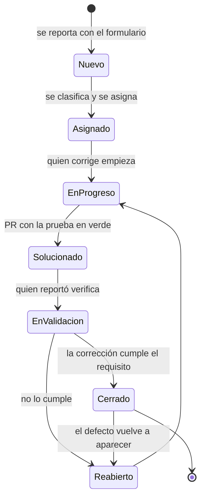

# Taller de Gestión de Defectos y Validación Final

Encontrar un defecto es la mitad del trabajo. La otra mitad es que **alguien más** lo entienda, lo reproduzca, decida cuándo corregirlo, lo corrija sin romper otra cosa, y que una tercera persona confirme que de verdad quedó corregido. Si cualquiera de esos pasos falla, el defecto vuelve, o peor: nunca se corrige y nadie se acuerda de que existía.

Este taller trabaja esa segunda mitad. El código que va a recibir **tiene defectos sembrados a propósito**, y su suite de pruebas **está en verde**. Las dos cosas son ciertas a la vez, y entender por qué es el punto de partida.

---

## Objetivos

- Distinguir **error, defecto y falla**, y usar una especificación como **oráculo**: la referencia que dice qué es correcto.
- Encontrar defectos **escribiendo pruebas** que los reproduzcan, no solo describiéndolos.
- Escribir **reportes que otra persona pueda reproducir** sin preguntar nada.
- Separar **severidad** (qué tan grave es) de **prioridad** (qué tan urgente es corregirlo), y justificar las dos con el **impacto**.
- Llevar cada defecto por su **ciclo de vida** en GitHub Issues, con **trazabilidad** del requisito a la prueba, al *pull request* y al cierre.
- Medir la calidad con **métricas que respondan preguntas**, en un tablero que se regenera a partir de los datos.
- Cerrar con un **informe de validación** que permita decidir si el sistema se puede entregar.

---

## Tabla de contenido

- [Sistema bajo prueba](#sistema-bajo-prueba)
- [Puesta en marcha](#puesta-en-marcha)
- [Ambiente de trabajo reproducible](#ambiente-de-trabajo-reproducible)
- [Módulos del taller](#módulos-del-taller)
- [Formato de la entrega](#formato-de-la-entrega)
- [Para entregar](#para-entregar-con-este-taller)
- [Rúbrica](#rúbrica)
- [Créditos y uso académico](#créditos-y-uso-académico)

---

## Sistema bajo prueba

Una Registraduría pequeña, sin base de datos ni servidor, para que todo el esfuerzo vaya a los defectos y no a la configuración. Tiene cuatro módulos, y su comportamiento correcto está escrito en [`docs/especificacion.md`](docs/especificacion.md) (requisitos `RF-01` a `RF-10`).

```text
.
├─ docs/
│   ├─ especificacion.md            # EL ORÁCULO: lo que el sistema debe hacer
│   └─ plantilla-informe-final.md   # módulo 6
├─ .github/ISSUE_TEMPLATE/
│   └─ defecto.yml                  # formulario de reporte (módulo 2)
├─ scripts/
│   ├─ crear-etiquetas.sh           # severidad, prioridad, estado, módulo (módulos 3 y 4)
│   └─ generar-tablero.sh           # exporta los issues y genera el tablero (módulo 5)
├─ ejemplos/
│   ├─ issues-ejemplo.json          # exportación de ejemplo (otro sistema)
│   └─ TABLERO-ejemplo.md           # el tablero que se genera con ella
└─ registraduria/
    ├─ src/main/java/.../registry/  # LO QUE SE PRUEBA: registro, comprobante,
    │                               #   importación CSV, estadísticas
    ├─ src/main/java/.../tablero/   # el generador del tablero (módulo 5)
    └─ src/test/java/...            # suite de partida, incompleta a propósito
```

| Módulo | Clase | Requisitos |
|---|---|---|
| registro | `Registry` | RF-01 a RF-07 |
| comprobante | `Comprobante` | RF-08 |
| importacion | `ImportadorCsv` | RF-09 |
| estadisticas | `Estadisticas` | RF-10 |

---

## Puesta en marcha

```bash
cd registraduria
mvn clean verify
```

**26 pruebas** en verde: 14 de la Registraduría y 12 del generador del tablero.

Y aun así, la Registraduría tiene **más de cinco defectos**. Ninguna de las 14 pruebas los detecta, porque ninguna prueba los casos donde están. Una suite verde solo afirma que los casos que alguien pensó funcionan; no dice nada de los que nadie pensó. Este taller empieza ahí.

> No busque los defectos leyendo el código de arriba abajo. Lea la **especificación**, diseñe los casos que la ponen a prueba, y deje que las pruebas le digan dónde está el problema. Así trabaja un equipo de calidad, que no siempre tiene el código a mano.

---

## Ambiente de trabajo reproducible

El repositorio trae su **ambiente definido como código** en [`.devcontainer/devcontainer.json`](.devcontainer/devcontainer.json): Java 17, Maven y GitHub CLI, en las mismas versiones para todo el curso. Es **opcional**: si ya tiene todo instalado, siga con la puesta en marcha de siempre.

- **GitHub Codespaces**, sin instalar nada: en la página del repositorio, *Code → Codespaces → Create codespace*. Consume la cuota gratuita de Codespaces: deténgalo al terminar.
- **VS Code y Docker** en su equipo: instale la extensión *Dev Containers*, abra la carpeta del repositorio y elija *Reopen in Container*.

GitHub CLI (`gh`) se usa en los módulos 4 y 5. Fuera del devcontainer, instálelo desde <https://cli.github.com/> y autentíquese con `gh auth login`.

---

## Módulos del taller

### Módulo 1 — Del fallo al defecto

Tres palabras que se usan como sinónimos y no lo son:

| Término | Qué es | En este taller |
|---|---|---|
| **Error** (equivocación) | Lo que hizo una persona: entendió mal un requisito, se le pasó un caso. | Ocurrió cuando se escribió el código. No se ve. |
| **Defecto** | Lo que quedó en el código por ese error. | Está en `registraduria/src/main`. No se ve hasta que se ejecuta. |
| **Falla** | Lo que se observa cuando el defecto se ejecuta con ciertas entradas. | Es lo que su prueba va a mostrar. |

Un defecto puede pasar años sin producir una falla si nadie usa las entradas que lo activan. Por eso **una suite verde no prueba que no haya defectos**: solo prueba que las entradas elegidas no los activan.

**El oráculo.** Para saber si un resultado es una falla hace falta una referencia que diga cuál era el correcto. Aquí es [`docs/especificacion.md`](docs/especificacion.md). Si el código y la especificación no coinciden, el defecto está en el código. Si la especificación es ambigua, eso también es un hallazgo, pero de otro tipo: se reporta como `pregunta`, no como `defecto`.

**Cómo buscar.** Con las técnicas de los talleres anteriores, requisito por requisito:

- **Clases de equivalencia y valores límite** en cada regla con rangos. Los límites son donde más se equivoca una persona.
- **El orden de las reglas** (RF-06). ¿Qué pasa con una entrada que cumple dos condiciones de rechazo a la vez?
- **Efectos colaterales.** ¿Qué deja guardado una operación que falló? ¿Qué pasa con la siguiente?
- **Formatos y textos exactos.** Un documento oficial con un texto o una fecha mal escritos es un defecto, aunque "funcione".
- **Entradas mal formadas.** Lo que la especificación dice que se debe tolerar, y lo que dice que se debe reportar sin detener el proceso.

Cada defecto que encuentre debe quedar como **una prueba que falla** mientras el defecto exista. Esa prueba es la evidencia del reporte, la guía de quien corrige y la protección contra que el defecto vuelva (regresión).

---

### Módulo 2 — Un reporte que otra persona pueda reproducir

El formulario [`.github/ISSUE_TEMPLATE/defecto.yml`](.github/ISSUE_TEMPLATE/defecto.yml) es la plantilla de reporte del curso. Cada campo existe porque, si falta, alguien tiene que volver a preguntarle:

| Campo | Para qué sirve |
|---|---|
| Requisito o caso que incumple | Trazabilidad: sin él, nadie puede validar que el cierre es correcto. |
| Módulo | Ubicar el defecto y medir dónde se concentran (módulo 5). |
| Pasos para reproducir | Mínimos y exactos, con los datos de entrada. |
| Resultado esperado | Lo que dice la especificación, citándola. |
| Resultado obtenido | La salida exacta, sin parafrasear. |
| Prueba que lo reproduce | Clase y método. Convierte el reporte en algo ejecutable. |
| Evidencia | Salida de Maven, *stack trace*. Texto mejor que capturas: se puede buscar. |
| Ambiente | Sistema operativo, versión de Java, *commit*. |
| Impacto | A quién afecta y qué pierde. Es la base del módulo 3. |

La diferencia entre un reporte inútil y uno útil (el ejemplo es de un sistema con API REST; el formato es el mismo para esta Registraduría):

> **Malo:** "Error al registrar votante."
>
> **Bueno:** "Con `edad = -1`, el endpoint `/register` responde 500 en el ambiente de QA. Esperado: 400 con resultado `INVALID_AGE` (RF-03). Prueba: `RegistryControllerIT#edadNegativaEsInvalida`. Log adjunto."

Tres reglas más:

- **Un defecto por issue.** Dos defectos en un mismo issue no se pueden cerrar por separado, y uno de los dos termina olvidado.
- **El título describe la falla, no la causa supuesta.** "La importación se detiene con una edad que tiene espacios" sirve; "Falta un trim()" adivina la corrección y puede estar equivocado.
- **El reporte es para un colega, no contra él.** Se describe el comportamiento, no a la persona que escribió el código. Un equipo donde reportar es acusar deja de reportar.

---

### Módulo 3 — Severidad, prioridad e impacto

No todos los defectos son iguales, y tratarlos igual tiene un costo: si todo es urgente, nada es urgente. Hay que decidir **dos cosas distintas**, que muchas veces deciden personas distintas:

- **Severidad**: qué tan grave es el defecto **técnicamente**. La propone quien prueba.
- **Prioridad**: qué tan **urgente** es corregirlo, considerando el negocio. La decide quien lidera, con negocio.

| Severidad | Criterio |
|---|---|
| `critica` | Bloquea una función esencial, corrompe o pierde datos, o incumple una obligación legal, sin alternativa. |
| `alta` | Una función importante da un resultado incorrecto; hay una alternativa, pero es costosa. |
| `media` | Una función secundaria falla, o el resultado incorrecto está acotado. |
| `baja` | Cosmético o de texto: no altera ningún resultado. |

| Prioridad | Criterio |
|---|---|
| `alta` | Se corrige en esta iteración. |
| `media` | Se corrige en la siguiente. |
| `baja` | Se corrige cuando haya capacidad. |

Las dos escalas **no van siempre juntas**, y los casos donde se separan son los que más enseñan. El ejemplo clásico: un error ortográfico como "Reguistro" en lugar de "Registro" tiene severidad **baja** (no cambia ningún resultado), pero prioridad **alta** si aparece en un documento oficial de una entidad del Estado. Al revés, un cálculo equivocado en un reporte interno que nadie consulta puede tener severidad media y prioridad baja.

Para decidir la prioridad, conteste en el campo *Impacto* del reporte:

- ¿A quién afecta, a cuántos y con qué frecuencia?
- ¿Es visible para el ciudadano o solo interno?
- ¿Hay una obligación legal o contractual de por medio?
- ¿Qué cuesta **esperar**? Un defecto barato de corregir hoy puede ser caro el mes que viene si se acumulan datos malos.

Las etiquetas se crean con [`scripts/crear-etiquetas.sh`](scripts/crear-etiquetas.sh) (necesita `gh auth login`). Cada defecto clasificado lleva exactamente **una** etiqueta `severidad:...`, **una** `prioridad:...` y **una** `modulo:...`.

---

### Módulo 4 — El ciclo de vida en GitHub Issues

GitHub Issues solo distingue entre abierto y cerrado. Las etapas intermedias se marcan con etiquetas `estado:...`:



| Transición | Quién | Cómo queda en GitHub |
|---|---|---|
| Reportar | Quien prueba | Issue con el formulario: `defecto`, `estado:nuevo` |
| Clasificar y asignar | Líder del equipo | `severidad:...`, `prioridad:...`, `modulo:...`, `estado:asignado` y un *assignee* |
| Corregir | Quien desarrolla | `estado:en-progreso`; una rama y un PR que dice `Closes #<n>` |
| Marcar como solucionado | Quien desarrolla | PR fusionado con la prueba de reproducción en verde: `estado:solucionado` |
| Validar | **Quien reportó**, nunca quien corrigió | `estado:en-validacion`; ejecuta la prueba y el escenario del reporte |
| Cerrar o reabrir | Quien validó | Cierra, o reabre con la etiqueta `reabierto` y un comentario que explica por qué |

Dos reglas que no se negocian:

- **Quien corrige no valida.** La persona que escribió la corrección tiene los mismos puntos ciegos que cuando escribió el defecto. En un equipo pequeño se rotan los roles, pero nunca sobre el mismo defecto.
- **`reabierto` no se quita al volver a cerrar.** Es lo que permite medir la tasa de reapertura (módulo 5). Quitarla para que la métrica se vea mejor es maquillar el tablero.

Al cerrar un PR con `Closes #<n>`, GitHub cierra el issue automáticamente al fusionarlo. Para este curso eso es **demasiado pronto**: el issue debe pasar por la validación. Use `Refs #<n>` en el PR y cierre el issue a mano después de validar.

Comandos útiles:

```bash
gh issue edit 12 --add-label "estado:en-validacion" --remove-label "estado:solucionado"
gh issue close 12 --comment "Validado: RegistryTest#... en verde y escenario del reporte correcto."
gh issue reopen 12 --comment "Sigue fallando con ..." && gh issue edit 12 --add-label reabierto
```

---

### Módulo 5 — Métricas y tablero

Las métricas convierten "creo que vamos bien" en datos. Pero una métrica que no responde una pregunta es decoración, y una que se usa para evaluar personas deja de medir lo que medía: si se premia reportar muchos defectos, aparecen defectos partidos en tres; si se premia cerrar rápido, se cierra sin validar.

El taller exige **cinco métricas mínimas**, cada una con su pregunta:

| # | Métrica | Pregunta que responde |
|---|---|---|
| 1 | Defectos por severidad | ¿Qué tan graves son? |
| 2 | Abiertos frente a cerrados | ¿Cuánto trabajo queda? |
| 3 | Tiempo medio de resolución (MTTR) | ¿Cuánto tardamos en cerrar un defecto? |
| 4 | Tasa de reapertura | ¿Nuestras correcciones son confiables? |
| 5 | Defectos por módulo y por requisito | ¿Dónde se concentran? ¿Qué requisito falla más? |

El generador ([`GeneradorDeTablero`](registraduria/src/main/java/edu/unisabana/tyvs/tablero/GeneradorDeTablero.java)) produce un tablero en Markdown con esas métricas, los gráficos (Mermaid, que GitHub dibuja en el repositorio y en el Wiki), la matriz severidad × prioridad, el **backlog priorizado** de abiertos y un control de **calidad del propio registro**: defectos sin clasificar o sin requisito trazado.

```bash
./scripts/generar-tablero.sh                        # corte: ahora
./scripts/generar-tablero.sh 2026-11-20T23:59:00Z   # corte fijo, para la entrega
```

El script exporta los issues a `metricas/issues.json` y genera `metricas/TABLERO.md`. **Los dos se versionan**: el tablero de una entrega debe poder regenerarse a partir de sus datos y su fecha de corte. Un tablero que no se puede regenerar es una captura de pantalla con otro formato.

Vea el resultado sobre una exportación de ejemplo, de otro sistema: [`ejemplos/TABLERO-ejemplo.md`](ejemplos/TABLERO-ejemplo.md).

> Las métricas del generador están probadas contra un JSON fijo ([`TableroTest`](registraduria/src/test/java/edu/unisabana/tyvs/tablero/TableroTest.java)), nunca contra GitHub. Una prueba que depende de la red y de los issues de hoy no es reproducible. Escribirlas encontró un defecto real del propio generador: `List.of(...).contains(null)` lanza una excepción en lugar de devolver `false`, y un defecto sin clasificar tiene severidad nula. Es el mismo tipo de caso que se le pide buscar en el módulo 1: la entrada que nadie pensó.

**Cuidado al interpretar:**

- Con pocos defectos, el MTTR y la tasa de reapertura cambian mucho con un solo caso. Dígalo en el informe en lugar de sacar conclusiones.
- Un módulo con muchos defectos puede ser el más defectuoso, o el más probado. Compárelo con cuántas pruebas tiene.
- Cero defectos abiertos no significa cero defectos. Significa cero defectos **conocidos** (módulo 1).

---

### Módulo 6 — Validación final e informe técnico

La pregunta que cierra el ciclo de pruebas no es "¿cuántos defectos encontramos?", sino **"¿se puede entregar?"**. Para contestarla se juntan dos miradas:

- **Verificación**: ¿construimos el producto correctamente? Lo responden las pruebas, la cobertura y los defectos cerrados y validados.
- **Validación**: ¿construimos el producto correcto? Lo responden las preguntas sobre la especificación, y lo que el usuario necesita y la especificación no dijo.

La respuesta se apoya en **criterios de salida** fijados antes de empezar (en el plan de pruebas), no después de ver los resultados. Por ejemplo: cero defectos críticos abiertos, ningún defecto alto sin un riesgo aceptado por escrito, la suite en verde en el pipeline.

El informe sigue la plantilla [`docs/plantilla-informe-final.md`](docs/plantilla-informe-final.md): resumen ejecutivo, alcance, resultados, defectos (métricas, relevantes y abiertos), verificación y validación, criterios de salida con una **decisión**, y lecciones aprendidas.

---

## Formato de la entrega

| Pregunta | Respuesta |
|---|---|
| ¿En qué formato se entrega? | **Repositorio de GitHub** con los defectos como **GitHub Issues** y el informe en el **Wiki**. Si el aula virtual exige un archivo, se sube el informe exportado a **PDF** y un `.zip` del repositorio como respaldo. |
| ¿Qué extensión tiene? | Cada reporte, lo que pide el formulario (sin mínimo de palabras: la claridad importa más que la longitud). El informe final, **de 4 a 8 páginas** exportado a PDF. |
| ¿Cuántas métricas? | Las **cinco** del módulo 5, como mínimo. No hay máximo, pero cada métrica adicional debe responder una pregunta que diga el informe. |
| ¿Lleva gráficos? | Sí: los del tablero (severidad, estado y módulo, como mínimo). Los genera el script; no hacen falta capturas ni Excel. |
| ¿Normas APA? | Solo para las fuentes externas que se citen, en **APA 7**. No es un trabajo de investigación: el código, los issues y la especificación se enlazan, no se citan. |
| ¿Se trabaja en grupo? | Sí, el mismo equipo del proyecto. Los roles (reporta, corrige, valida) rotan entre defectos. |

---

## PARA ENTREGAR CON ESTE TALLER

> **Ejercicio y proyecto.** Lo que pide esta sección es el **ejercicio** de la unidad 6 y se entrega sobre esta Registraduría. La entrega del **proyecto** de la unidad 6 aplica lo mismo al **caso de su equipo** (ver el [catálogo de casos](https://github.com/CesarAVegaF312/TYVS-Proyecto_Pruebas_Unitarias/blob/master/casos/README.md)): los defectos que el equipo encontró en su caso a lo largo del curso, consolidados en GitHub Issues del repositorio del proyecto con esta misma plantilla y estas etiquetas (cambiando los módulos por los de su caso), su tablero con fecha de corte y el informe final de validación.
>
> El [Taller de Economía de las Pruebas](https://github.com/CesarAVegaF312/TYVS-Taller_Economia_de_las_Pruebas) es complementario en esta unidad: mide la efectividad de la suite que encontró (o no encontró) estos defectos.

### 1) Repositorio

- Una copia de este repositorio con **Issues habilitados**. Si hace *fork*, habilítelos en *Settings → General → Features*: en los *forks* vienen desactivados.
- Etiquetas creadas con `scripts/crear-etiquetas.sh`.
- `mvn clean verify` en verde al final, con **todas** sus pruebas nuevas incluidas.

### 2) Defectos encontrados y reportados (módulos 1 y 2)

- Al menos **5 defectos** reales de la Registraduría (hay más), cada uno como issue con el formulario y con **la prueba que lo reproduce**.
- Al menos **1 ambigüedad** de la especificación reportada como `pregunta`, con la decisión que tomó el equipo.

### 3) Clasificación (módulo 3)

- Severidad y prioridad en cada defecto, con el impacto justificado en el reporte.
- Al menos un defecto donde severidad y prioridad **no coincidan**, con la justificación.

### 4) Ciclo de vida completo (módulo 4)

- Cada defecto reportado debe estar **cerrado y validado**, o abierto con la decisión escrita de por qué no se corrigió.
- Cada corrección en un PR que referencia su issue, con la prueba de reproducción en verde.
- Quien validó no es quien corrigió. Si una corrección no resolvió el defecto, el issue se reabrió con su etiqueta: eso no resta puntos, ocultarlo sí.

### 5) Tablero (módulo 5)

- `metricas/issues.json` y `metricas/TABLERO.md` generados con la **fecha de corte** de la entrega.
- Las cinco métricas mínimas, cada una con una interpretación de una o dos frases (en el informe).

### 6) Informe final (módulo 6, en el Wiki)

- Con la [plantilla](docs/plantilla-informe-final.md), incluida la **decisión** sobre si el sistema se puede entregar.

### 7) Reflexión final (en el Wiki)

Una de estas dos, a elección:

- La suite de partida estaba en verde y el código tenía defectos. ¿Qué tendría que haber hecho el equipo que la escribió para encontrarlos antes?
- ¿Qué defecto le costó más **reportar bien** que encontrar, y por qué?

---

## Rúbrica

| **Criterios de evaluación** | **Indicadores** | **Excelente (5 pts)** | **Bueno (4 pts)** | **Necesita mejorar (3.5 pts)** | **Deficiente (2.5 pts)** | **No cumple (0 pts)** |
|---|---|---|---|---|---|---|
| **Estructura y ejecución** | El repositorio corre y las correcciones no rompen nada. | `mvn clean verify` en verde con todas las pruebas nuevas y el pipeline en verde. | En verde con ajustes menores. | Pruebas nuevas desactivadas o fuera de la suite. | Falla en varias pruebas. | No ejecuta. |
| **Detección de defectos** | Defectos reales encontrados con pruebas. | 6 o más defectos reales, cada uno con su prueba de reproducción, y una ambigüedad reportada. | 5 defectos con prueba. | 3 o 4 defectos, o sin prueba de reproducción. | 1 o 2 defectos. | No encuentra defectos. |
| **Calidad de los reportes** **(vale por 2)** | Otra persona puede reproducirlos sin preguntar. | Todos con pasos mínimos, esperado citando el requisito, obtenido exacto, prueba, evidencia e impacto; un defecto por issue. | Reproducibles con algún campo pobre. | Hay que preguntar para reproducir varios. | Reportes vagos ("no funciona"). | Sin reportes. |
| **Clasificación e impacto** | Severidad y prioridad justificadas. | Las dos escalas aplicadas con criterio, el impacto justifica cada decisión y hay un caso donde no coinciden. | Clasificación correcta con justificación parcial. | Severidad y prioridad usadas como si fueran lo mismo. | Clasificación arbitraria o incompleta. | Sin clasificar. |
| **Ciclo de vida y trazabilidad** | Requisito → issue → prueba → PR → validación → cierre. | Todos los defectos recorren el ciclo, validados por otra persona, con reaperturas registradas honestamente. | Ciclo completo con algún salto de estado. | Se cierra sin validar, o quien corrige valida. | Issues cerrados sin evidencia. | Sin ciclo. |
| **Métricas y tablero** **(vale por 2)** | Medición reproducible e interpretada. | Tablero regenerable con fecha de corte, las cinco métricas interpretadas, sus límites reconocidos. | Tablero y métricas correctos, interpretación superficial. | Faltan métricas o el tablero no se puede regenerar. | Números sin interpretar o hechos a mano. | Sin métricas. |
| **Informe final y reflexión** | Decisión de entrega fundamentada. | Informe completo con criterios de salida, decisión argumentada con datos y lecciones concretas. | Informe completo, decisión poco argumentada. | Informe incompleto o sin decisión. | Mínimo. | Sin informe. |

> **Cómo suma**: 9 criterios × 5 pts = **45 puntos**. Son 7 filas, pero *Calidad de los reportes* y *Métricas y tablero* valen por dos cada una: son el núcleo del saber del syllabus (claridad en los reportes y métricas de calidad).

| Rango de puntaje | Desempeño |
| ---------------- | --------- |
| 41 – 45 | Excelente dominio técnico y metodológico. |
| 32 – 40 | Buen trabajo con documentación o análisis parcial. |
| 27 – 31 | Cumple con lo básico pero sin profundidad. |
| < 27 | No cumple con los criterios mínimos del taller. |

---

## Créditos y uso académico

Material del curso **Testing y Validación de Software**, Maestría en
Ingeniería de Software, **Universidad de La Sabana**.

El código de `registraduria/src/main/java/.../registry` tiene **defectos sembrados a propósito**. No lo copie a un proyecto real, y no publique la lista de defectos ni sus correcciones: el ejercicio de los siguientes grupos depende de ello.

---

### Licencia de uso

Este material se distribuye bajo la licencia [Creative Commons Atribución-NoComercial-CompartirIgual 4.0 Internacional (CC BY-NC-SA 4.0)](https://creativecommons.org/licenses/by-nc-sa/4.0/deed.es).

Puedes **usar, adaptar o compartir** este contenido con fines educativos, siempre que:

1. Se reconozca la autoría del profesor **César Augusto Vega Fernández**.
2. No se utilice con fines comerciales.
3. Las obras derivadas se distribuyan bajo la misma licencia.
