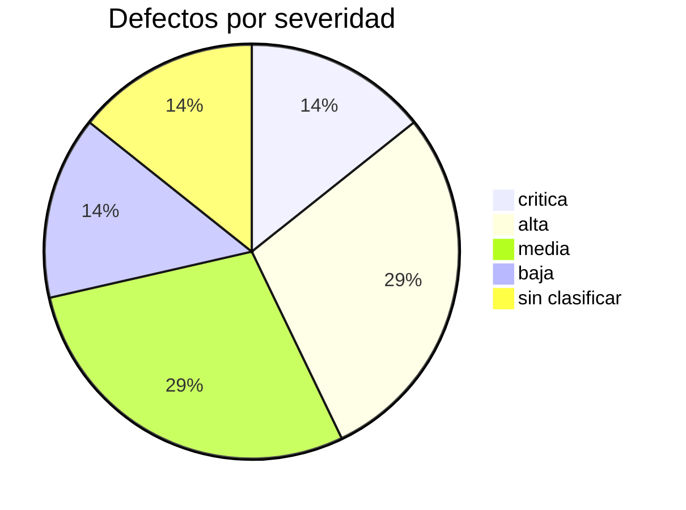
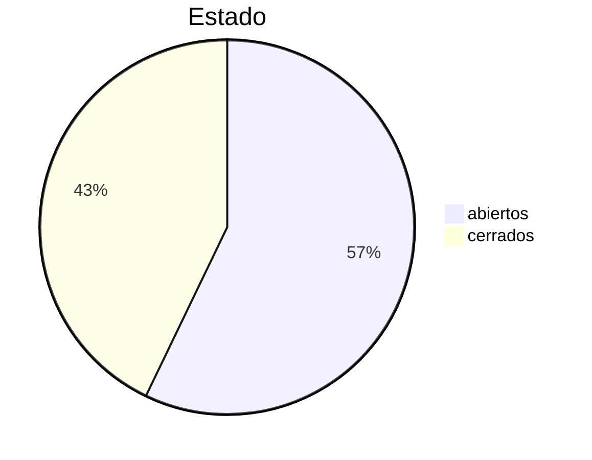
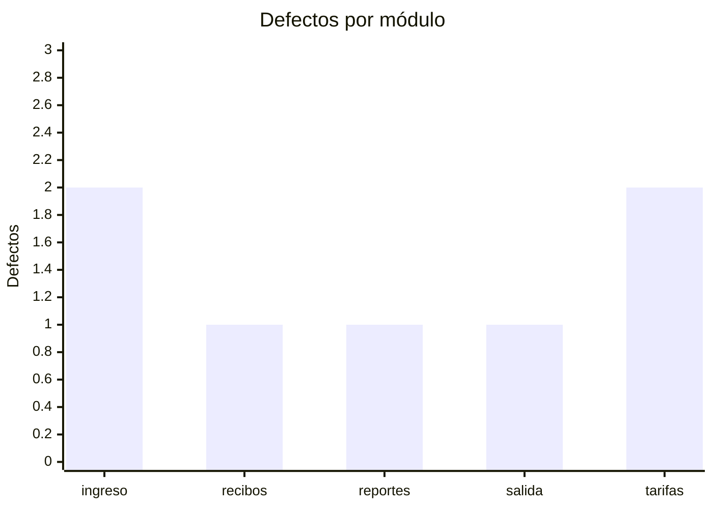

# Tablero de defectos

Corte: 2026-03-10 09:00 UTC a partir de 7 issues con la etiqueta `defecto`.

## Resumen

| Métrica | Valor | Pregunta que responde |
|---|---|---|
| Defectos registrados | 7 | ¿Cuántos encontramos? |
| Abiertos / cerrados | 4 / 3 | ¿Cuánto trabajo queda? |
| Tiempo medio de resolución (MTTR) | 3.2 días | ¿Cuánto tardamos en cerrar un defecto? |
| Tasa de reapertura | 50% | ¿Nuestras correcciones son confiables? |
| Críticos y altos abiertos | 2 | ¿Podemos entregar? |

## Defectos por severidad

| Severidad | Defectos |
|---|---|
| critica | 1 |
| alta | 2 |
| media | 2 |
| baja | 1 |
| sin clasificar | 1 |

## Abiertos y cerrados

## Defectos por módulo

| Módulo | Defectos |
|---|---|
| ingreso | 2 |
| recibos | 1 |
| reportes | 1 |
| salida | 1 |
| tarifas | 2 |

## Defectos por requisito

| Requisito | Defectos |
|---|---|
| RF-01 | 1 |
| RF-02 | 1 |
| RF-03 | 1 |
| RF-04 | 1 |
| RF-05 | 1 |
| RF-07 | 1 |
| RF-09 | 1 |

## Severidad y prioridad

| Severidad \ Prioridad | alta | media | baja |
|---|---|---|---|
| critica | 1 | 0 | 0 |
| alta | 2 | 0 | 0 |
| media | 0 | 1 | 1 |
| baja | 1 | 0 | 0 |

## Backlog priorizado (abiertos)

| # | Título | Prioridad | Severidad | Días abierto |
|---|---|---|---|---|
| #4 | Con el parqueadero lleno, el sistema asigna el puesto 0 | alta | critica | 5 |
| #6 | La salida de una moto se cobra con tarifa de carro | alta | alta | 6 |
| #5 | El reporte diario redondea los ingresos hacia abajo | baja | media | 3 |
| #7 | El botón de salida no responde a veces | sin clasificar | sin clasificar | 1 |

## Calidad del registro

- **1** defecto(s) sin severidad o sin prioridad (no se pueden priorizar): #7.
- **1** defecto(s) sin requisito trazado (no se puede validar su cierre): #7.
